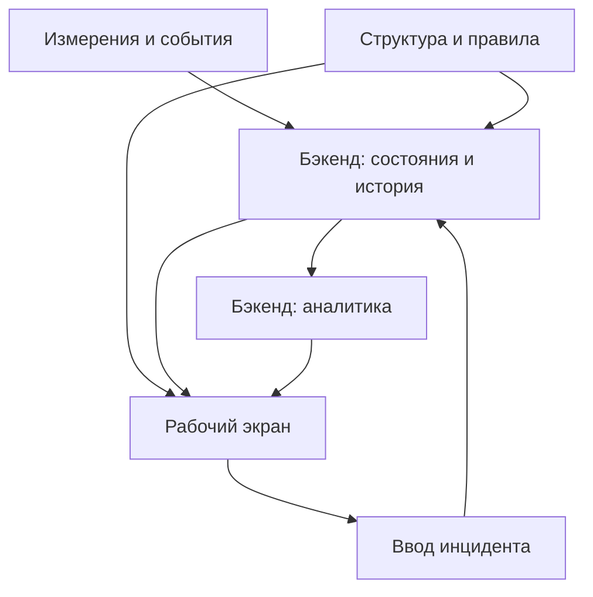

FKIT-BI: пользовательские сценарии и потоки данных
Материал для агента, который будет сопоставлять вариант фронт-разработчика с текущим бэкендом.
1. Назначение и границы описания
Исходные материалы: image(2).png, image(3).png, draft-api.yaml. Скриншоты показывают карточку машины «Флексопечать ФП-1» на предприятии «Завод полимерной упаковки», внутри линии «Печать и резка». Один вариант тёмный и компактный, другой светлый и широкий. Это два представления одного набора задач, а не доказательство существования двух разных приложений. Широкий вариант позволяет увидеть нижние блоки страницы, обрезанные на компактном снимке.
Это описание пользовательского поведения и информационных потребностей. Здесь не задаются URL, методы запросов, DTO, таблицы, формулы расчёта или обязательное разбиение на сервисы из черновика.
Бэкенд является источником правды. Агент должен изучить актуальный код, предметную модель, расчёты и контракты, после чего определить, какие сценарии уже поддержаны, где нужна адаптация фронта, а где обоснована доработка бэкенда. Черновик помогает понять замысел фронт-разработчика, но не доказывает наличие функции в нашей реализации.
Обозначения основания:
- Скриншоты: компонент или действие непосредственно видны. Скриншот подтверждает интерфейс, но не подтверждает результат нажатия.
- Черновик: сценарий или данные описаны в приложенном файле, однако соответствующий экран может отсутствовать.
- Рекомендация: предлагаемое согласованное поведение; его необходимо проверить и адаптировать к текущей системе.
Репозитории бэкенда в рамках этого анализа не исследовались. Ни одна описанная возможность не объявляется уже реализованной.
2. Из каких компонентов складывается рабочий экран
Компонент	Что пользователь видит и зачем	Основание
Верхняя панель	Путь до выбранного объекта, период «30 дней», «Все смены / День / Ночь», управление обновлением, «Администратор», дополнительные значки	Скриншоты
Дерево предприятия	Линии, машины внутри линий, раскрытие ветвей, цветные индикаторы машин, выделение выбранной машины	Скриншоты
Поиск машины	Поле для быстрого поиска оборудования в навигации	Скриншоты; алгоритм поиска не показан
Обзор предприятия	Точка перехода к общему обзору	Скриншоты; целевой экран не показан
Сводка машины	Название, линия, тип, инвентарный номер, состояние «АВАРИЯ» и длительность этого состояния	Скриншоты
Показатели периода	«Полезная работа», «Неплановый простой», «Остановки», сравнение, доступность, производительность, MTBF, MTTR, плановые потери, время без данных	Скриншоты
Паспорт и текущие параметры	Инвентарный номер, тип, производитель, год ввода, номинальная скорость, температура, счётчик за смену	Скриншоты
Телеметрия	Индикаторы скорости и загрузки, графики скорости и температуры за последний час, отметка обновления	Скриншоты
Потери	Диаграмма по времени, легенда причин, переключатель «По времени / Парето»	Скриншоты; вид Парето не открыт
Хронометраж	День и ночь, выбранная дата, временные полосы состояний и причин, длительности; пустой блок «Нет данных за период»	Светлый скриншот
Интервалы и инциденты	Фильтры состояния и причины, «Только простои», счётчик «Не указано», колонки начала, конца, длительности, состояния, причины, комментария и автора	Светлый скриншот; видна верхняя часть таблицы
Регистрация инцидента	Кнопка на карточке машины	Скриншоты; форма не открыта
Журнал инцидентов и администрирование	Отдельные пункты навигации	Скриншоты; страницы не показаны
Меню блоков, тема, дополнительные режимы	Меню с тремя точками, значки в верхней панели	Скриншоты; состав команд и назначение части значков неизвестны

Цветные точки в дереве предполагают быструю оценку состояния машин, но точное соответствие цветов состояниям на снимках не раскрыто. Красный индикатор выбранной машины согласуется с показанной аварией; универсальную цветовую шкалу по одному примеру задавать нельзя.
3. Общая модель рабочего контекста
Пользователь выбирает объект внутри структуры предприятие → линия → машина, затем исследует его работу за период и уточняет причины потерь. На карточке одновременно присутствуют несколько временных контекстов:
1. Период аналитики: например, последние 30 дней; используется для сводки и анализа потерь.
2. Фильтр смен: все смены, дневные или ночные; уточняет выбранный период.
3. Текущее состояние: что происходит с машиной сейчас и как давно.
4. Короткое окно телеметрии: на снимке — последний час.
5. Дата хронометража: конкретные дневная и ночная смены.
6. Окно таблицы интервалов: должно иметь понятную связь с периодом и локальными фильтрами; точная связь из снимка не установлена.
Эти контексты нельзя незаметно смешивать. Например, выбор прошлого месяца не должен превращать сегодняшнее аварийное состояние в «состояние прошлого месяца». Заголовок «за последний час» должен соответствовать фактически показанному окну, даже если основной период равен 30 дням.
Для согласованной работы агенту следует проверить, какие фильтры глобальны, какие локальны, что сохраняется при переходе на другую машину и что хранится в состоянии страницы. Сохранение периода и смены при переходе между машинами — полезная рекомендация для сравнения, но не доказанное поведение прототипа.
4. Сценарий: найти и открыть нужную машину
Цель: быстро перейти к оборудованию, которое требует внимания.
Путь пользователя:
1. Пользователь открывает систему и видит структуру предприятия.
2. Раскрывает линию, если её машины скрыты.
3. Просматривает названия и индикаторы состояния; при необходимости вводит название в поиск.
4. Выбирает машину. На снимках выбранная строка подсвечена.
5. На странице появляются её сводка, паспорт, телеметрия, потери, хронометраж и интервалы.
6. Путь в верхней панели помогает проверить, что открыта нужная машина нужной линии.
7. Пользователь выбирает другую машину или возвращается к обзору предприятия.
Поток данных: бэкенд предоставляет структуру объектов и актуальные состояния; фронт собирает дерево. Выбор машины становится общим контекстом для блоков карточки. Каждый блок получает данные именно выбранного объекта, а не сохраняет данные предыдущей машины под новым заголовком.
Что проверить агенту: поиск фильтрует дерево или показывает отдельные результаты; есть ли поиск по инвентарному номеру; раскрываются ли родительские ветви найденной машины; кликабельно ли название линии; доступен ли выбор предприятия. Последний на снимках не показан. Обзор предприятия подтверждён пунктом навигации, а самостоятельный экран линии только предполагается и поддерживается аналитическими областями в черновике.
Рекомендации для пограничных случаев: пустая линия показывается как пустая; недоступная машина не подменяется первой из списка; при быстром переключении устаревший результат загрузки не должен перезаписать карточку нового объекта.
5. Сценарий: выбрать период и смены
Цель: ответить на вопрос, как машина работала в интересующий промежуток.
1. Пользователь открывает управление периодом. На снимках выбран вариант «30 дней»; наличие произвольного диапазона или других пресетов не доказано.
2. Выбирает доступный период.
3. Оставляет «Все смены» либо выбирает «День» или «Ночь».
4. Сравнивает сводные показатели и потери в новом контексте.
5. При необходимости переключает смену для сравнения дневной и ночной работы.
Поток данных: фронт передаёт выбранный аналитический контекст бэкенду; бэкенд применяет принятые правила времени, смен и расчётов; фронт показывает согласованный результат в затронутых блоках. На снимках у основных показателей есть изменения относительно некоторой базы сравнения, а черновик предполагает показатели предыдущего периода. Точное определение предыдущего периода нужно установить по бэкенду.
Особенности: время предприятия и границы смен должны применяться одинаково. Ночная смена может пересекать полночь: принадлежность такой смены дате нельзя определять только датой отдельных событий. Для незавершённой смены агент должен проверить, как учитывается прошедшая часть и как строится сопоставимый предыдущий период.
Результат: пользователь понимает, к какому времени относятся показатели. При смене фильтра старые значения не должны выглядеть как уже пересчитанные. Пустой диапазон и ошибка загрузки — разные состояния интерфейса.
6. Сценарий: оценить состояние и показатели машины
Цель: решить, требует ли машина немедленного вмешательства и насколько значимы её потери за период.
1. Пользователь читает название, линию, тип и инвентарный номер.
2. Проверяет текущий статус — в примере «АВАРИЯ» — и подпись длительности.
3. Смотрит три основных показателя: полезную работу, неплановый простой и количество остановок.
4. Читает изменения показателей и дополнительные значения: доступность, производительность, MTBF, MTTR, плановые потери и отсутствие данных.
5. Если проблема видна, переходит к причинам потерь, хронометражу или регистрации инцидента.
Поток данных: идентификация машины приходит из её описания; статус и момент начала состояния — из актуальной серверной модели; показатели периода — из аналитического результата. Обновление текущего состояния не обязательно означает одновременную готовность исторических агрегатов. Агент должен учесть фактическую задержку расчётов.
Смысл, который нужно сохранить: текущее состояние и историческая эффективность отвечают на разные вопросы. Машина может находиться в аварии сейчас и иметь высокую долю работы за месяц. Длительность текущего состояния не равна суммарному простою за период.
Ограничения интерпретации: «Полезная работа», доступность и производительность показаны как отдельные значения; считать их одним показателем нельзя. Здесь не фиксируются формулы. Не следует автоматически объявлять экран расчётом OEE: показатель качества на снимках не виден. Нулевое число остановок, отсутствие телеметрии или невозможность вычислить показатель должны обрабатываться по правилам бэкенда, а не заменяться правдоподобными числами.
7. Сценарий: проверить паспорт и текущую телеметрию
Цель: сопоставить наблюдаемую работу с характеристиками оборудования.
1. Пользователь сверяет паспорт машины: номер, тип, производитель, год ввода, номинальная скорость.
2. Смотрит текущие параметры, в том числе температуру и счётчик за смену.
3. Читает скорость и загрузку на индикаторах.
4. Проверяет отметку последнего обновления.
5. Рассматривает графики скорости и температуры за последний час: были ли резкое снижение, рост или изменение режима.
6. Сопоставляет это с текущей аварией и хронометражем.
Поток данных: паспорт берётся из описания оборудования; текущие измерения и временные ряды поступают из серверных данных наблюдения. Номинальное значение, реальные измерения, счётчик за смену и вычисленный показатель загрузки могут иметь разные источники. Их назначение и единицы нужно установить по актуальной реализации.
Что не определено: способ расчёта загрузки; допустимые диапазоны и цвета шкал; перечень сигналов конкретной машины; правило сброса счётчика за смену; поведение графиков при выборе исторического периода. Черновик предполагает конфигурацию сигналов машины, но это не требование внедрить именно его модель OPC-тегов.
Рекомендации: не показывать отсутствие температуры как 0 °C; отмечать устаревшие значения; не соединять длинный участок отсутствия измерений так, будто машина непрерывно передавала данные. Если один сигнал отсутствует, остальные доступные данные остаются полезными.
8. Сценарий: исследовать потери во времени
Цель: определить, когда возникали потери и какие причины их сформировали.
1. Пользователь открывает блок «Потери по времени».
2. Проверяет период и выбранные смены.
3. Изучает составные столбцы: высоту потерь в каждом временном участке и доли отдельных причин.
4. Сопоставляет цвета с легендой.
5. Находит дни с высокими потерями либо повторяющуюся причину.
6. Для подробного разбора обращается к хронометражу нужной даты и таблице интервалов.
На широком снимке видна последовательность дневных столбцов. В легенде представлены, например, «Не указано», «Замятие / обрыв», «Обед», «Нет оператора», «Поломка механики», «Переналадка», «Отказ электрики», «ТО», «Ожидание ОТК», «Нет сырья», «Чистка / уборка». Это примеры из интерфейса, а не утверждённый обязательный справочник нашей системы.
Поток данных: бэкенд рассчитывает длительности потерь по причинам и временным участкам; фронт визуализирует эти значения и согласует их со справочником названий и цветов. Агент должен проверить, как сервер учитывает открытый простой, пересечение смен и периодов, отсутствие причины и возможное перекрытие ручных записей.
Не доказано снимком: клики по столбцам, всплывающие подсказки, отключение серий через легенду или автоматический переход к выбранному дню. Их можно предложить как улучшение, но нельзя считать уже существующим user flow. На компактном снимке у легенды видны стрелки и «1/2», что указывает на постраничное представление легенды, а не на страницы данных графика.
9. Сценарий: выделить основные причины через Парето
Цель: понять, какие причины дают наибольшие потери и заслуживают первоочередных действий.
1. Пользователь анализирует потери по времени.
2. Переключает блок в режим «Парето».
3. Просматривает ранжирование причин за тот же объект, период и фильтр смен.
4. Выбирает наиболее значимую причину для дальнейшего исследования.
5. Возвращается к временной диаграмме или ищет соответствующие интервалы.
Основание: переключатель виден; сам график Парето на скриншотах отсутствует. Черновик предполагает суммарные длительности, доли и накопленные доли причин.
Поток данных: тот же набор потерь агрегируется и ранжируется сервером по принятым правилам. Переключение формы анализа не должно незаметно менять период или исключать часть данных.
Что проверить агенту: сколько причин выводится; учитываются ли неуказанные причины; что происходит с остальными причинами; как рассчитывается доля. Прямой переход из элемента Парето в таблицу не подтверждён и остаётся возможным улучшением.
10. Сценарий: разобрать хронометраж конкретной смены
Цель: восстановить последовательность работы и остановок в течение смены.
1. Пользователь переходит к блоку «Хронометраж топа потерь».
2. Выбирает дату через видимое управление датой и соседними стрелками. Точный шаг переключения нужно проверить.
3. Изучает отдельно дневную и ночную смены.
4. По общей строке состояний понимает, когда машина работала и меняла состояние.
5. По отдельным строкам причин видит, когда происходили конкретные потери и как долго они длились.
6. Сопоставляет события со скоростью, температурой, известной остановкой и записью инцидента.
7. Для неизвестной причины переходит к уточнению в таблице или регистрации инцидента.
На снимке дневная смена подписана «08:00–20:00», ночная — «20:00–08:00». Эти часы являются примером конкретного предприятия. В ночном блоке показано «Нет данных за период»; это не доказательство отсутствия остановок или полностью полезной работы.
Поток данных: расписание и часовой пояс определяют границы смены; серверные интервалы дают последовательность состояний; причины и ручные пояснения дают смысл отдельных участков; аналитика определяет набор основных потерь. Фронт располагает их на общей временной оси.
Особенности для проверки: дата начала ночной смены, отсечение интервала на границе смены, открытый текущий интервал, будущая часть смены, показ потерь вне выбранного топа. Если отображаются только основные причины, их сумма может не равняться всем потерям смены. Общая строка состояний не должна исчезать из-за ограничения числа причин.
11. Сценарий: найти конкретный интервал и неуказанную причину
Цель: перейти от общей аналитики к фактам о конкретной остановке.
1. Пользователь прокручивает страницу до «Интервалы и инциденты».
2. Просматривает начало, конец, длительность, состояние и причину.
3. При необходимости выбирает фильтр состояния или причины.
4. Включает «Только простои», если хочет убрать работу и сосредоточиться на потерях.
5. Обращает внимание на индикатор «Не указано» и на строки без причины.
6. Читает комментарий и автора, если к интервалу относится ручная запись.
7. Уточняет конкретный случай через доступное действие регистрации или редактирования инцидента.
Поток данных: сервер предоставляет временные интервалы и их связь с инцидентами; справочник объясняет причину; фронт показывает таблицу в согласованном контексте. Какая часть фильтрации выполняется на сервере, агент решает по текущему контракту и объёму данных.
Что не установлено: означает ли счётчик «Не указано» число интервалов или другую величину; кликабелен ли он; есть ли открытие строки; как работает сортировка; есть ли пагинация и какие интервалы входят в «Только простои». Нижняя часть таблицы обрезана, поэтому эти возможности не следует выдумывать.
Рекомендация: различать автоматически обнаруженный интервал состояния и ручной инцидент. Они связаны, но не обязательно имеют взаимно однозначное соответствие. Один инцидент может пересекать несколько интервалов, а интервал может быть без пояснения.
12. Сценарий: зарегистрировать инцидент
Цель: добавить производственное объяснение к наблюдаемой остановке.
1. Пользователь замечает аварию, неизвестную причину или существенную потерю.
2. Нажимает «Зарегистрировать инцидент» на карточке машины.
3. Открывается форма; её внешний вид на скриншотах отсутствует.
4. Пользователь указывает временные границы и причину, добавляет пояснение. Черновик предполагает возможность незавершённого инцидента.
5. Проверяет привязку к машине и время, затем сохраняет.
6. Бэкенд проверяет полномочия и предметные ограничения, сохраняет запись и применяет принятые правила связи с потерями.
7. Пользователь видит подтверждение и сохранённую запись.
8. Связанные представления обновляются: таблица, журнал, причины потерь, хронометраж и, если правила расчётов этого требуют, сводка.
Основание: кнопка видна; временные границы, причина, комментарий, автор и редактирование инцидента отражены в черновике. Автоматическое заполнение формы из текущей аварии или выбранного интервала — рекомендация, а не показанная функция.
Главный смысл: автоматические данные отвечают на вопрос «что и когда происходило», ручная запись — «почему это произошло и что известно пользователю». Черновик предполагает влияние причины инцидента на пересекающиеся простои. Реальное правило такой связи агент должен проверить по бэкенду: нельзя слепо перенести правило замены из прототипа.
Рекомендации: машина должна быть очевидна в форме; ошибка сохранения должна оставлять введённый текст; отмена не создаёт запись; повторное нажатие не должно случайно дублировать инцидент. Авторство следует получать из принятой сервером модели пользователя, если она существует, а не доверять произвольной подписи фронта.
Уточнение причины не должно само по себе переписывать фактическую телеметрию или изображать устранение аварии. Если изменение причины переводит потери между плановыми и неплановыми, это влияние должно следовать серверным правилам и отражаться согласованно.
13. Сценарий: работать с журналом и изменять инциденты
Цель: искать, проверять и дополнять ранее зарегистрированные производственные события.
1. Пользователь открывает пункт «Журнал инцидентов».
2. Просматривает записи в доступном ему контексте.
3. Находит нужный случай по машине и времени; такие критерии поддерживаются замыслом черновика.
4. Открывает подробности, проверяет границы, причину и комментарий.
5. При наличии полномочий исправляет причину, пояснение или временные границы; закрытие незавершённого случая возможно, если его поддерживает текущая система.
6. Сохраняет и проверяет согласованность журнала и аналитики машины.
Основание: пункт журнала виден, операции чтения, изменения и удаления описаны в черновике; дизайн журнала и действия на нём не показаны.
Поток данных при изменении: новая версия ручного объяснения поступает в бэкенд; сервер заново определяет её влияние на интервалы и аналитические представления; фронт получает актуальный результат. Для изменений границ важно обновить также ранее затронутый участок, если он больше не относится к инциденту.
Удаление нельзя объявлять обязательным способом работы только потому, что оно предусмотрено черновиком. Агент должен проверить текущие полномочия, аудит и принятую модель исправления записей. Из снимков не следует наличие истории изменений, подтверждения удаления или поиска по всем предприятиям.
14. Сценарий: подготовить и поддерживать производственную структуру
Цель: сделать так, чтобы навигация, паспорт, смены, причины и расчёты описывали реальные объекты.
Основание: пункт «Администрирование» виден. Следующие действия восстановлены из черновика; формы настройки не показаны.
1. Уполномоченный пользователь создаёт или изменяет предприятие, его часовой пояс и расписание смен.
2. Добавляет линии, меняет названия и порядок.
3. Добавляет машины и заполняет идентификацию, паспорт и номинальные характеристики.
4. Настраивает доступные сигналы и смысл состояний в рамках модели, поддержанной бэкендом.
5. Поддерживает справочник причин потерь, их группировку, плановый характер и визуальное представление.
6. При необходимости переносит машину или выводит её из активной структуры, если это поддерживается системой.
7. Проверяет, что изменения отражены в дереве, карточке, формах инцидентов и аналитике.
Поток данных: изменение конфигурации сохраняется сервером; фронт обновляет справочники и связанные экраны. Структура и правила не должны существовать только в локальных моках фронта.
Что проверить агенту: влияние изменения расписания, номинальной скорости, правил состояний и плановости причины на прошлые расчёты; сохранность истории после переноса или архивирования машины; обработка причин, которые уже используются. Ретроспективный пересчёт не должен возникать случайно как побочный эффект редактирования.
Поле «Администратор» в верхней панели не доказывает настоящую авторизацию или перечень ролей. Агент должен сопоставить его с действующей моделью доступа. Переключение подписи на фронте само по себе не предоставляет серверных прав.
15. Сценарий: обновлять данные и менять представление
Цель: наблюдать систему с понятной свежестью данных и удобной компоновкой.
В верхней панели видны круговая стрелка и элемент «Выкл», вероятно относящиеся к ручному и автоматическому обновлению. Точное назначение и доступные режимы нужно проверить во фронте.
Предполагаемый путь: пользователь запускает ручное обновление либо включает доступный режим автоматического обновления; текущие данные и аналитика загружаются заново в выбранном контексте; обновляются состояние, длительность, параметры и зависимые представления. Способ доставки — периодическая загрузка, поток или другой механизм — здесь не задаётся.
Рекомендации: обновление сохраняет выбранную машину, период и локальные фильтры; не сбрасывает редактируемую форму; не подменяет реальные измерения случайными демонстрационными числами. Последнее успешное значение может оставаться видимым при ошибке, но с отметкой устаревания. Время свежести желательно показывать для тех данных, к которым оно действительно относится.
Тёмный и светлый варианты подтверждают разные оформления, но не доказывают работу переключателя темы. Компактный снимок показывает необходимость прокрутки; широкий — размещение сводки и параметров рядом. Меню с тремя точками и дополнительные значки видны, но их действия неизвестны. Экспорт, полноэкранный режим, настройку виджетов и другие команды нельзя объявлять реализованными без проверки.
16. Сквозные потоки данных
Ниже показаны логические обязанности. Схема не предписывает отдельные микросервисы и не утверждает наличие конкретных компонентов в текущем коде.

Поток	Откуда берётся информация	Что получает пользователь	Что сверить с бэкендом
Структура	Предприятие, линии, машины, их связи	Дерево, поиск, путь, паспорт	Идентичность объектов, область доступа, активность и порядок
Текущее наблюдение	Последние измерения и текущее состояние	Индикаторы, статус, длительность, свежесть	Правила состояний, единицы, задержка и отсутствие связи
История	Измерения и интервалы за время	Графики, таблица, хронометраж	Границы времени, открытые интервалы, пропуски
Аналитика	Серверная обработка истории в контексте	KPI, сравнение, потери по времени и причинам	Формулы, фильтры смен, согласованность агрегатов
Ручное объяснение	Инцидент от уполномоченного пользователя	Причина, комментарий, автор	Валидация, пересечения, права, влияние на расчёты
Конфигурация	Изменения структуры и правил	Обновлённые справочники и представления	Влияние на текущие и исторические данные

Путь чтения: пользователь выбирает объект и временной контекст; сервер возвращает факты и результаты расчётов; фронт показывает их в соответствующих блоках.
Путь записи: пользователь вводит пояснение или меняет настройку; сервер принимает решение о допустимости и сохраняет изменение; зависимые представления обновляются из серверного результата. Фронт не должен объявлять операцию успешной до серверного подтверждения.
Источник правды не означает, что всё обновляется мгновенно. Если текущая реализация рассчитывает агрегаты с задержкой, интерфейс должен учитывать её, чтобы новая запись и старое распределение потерь не выглядели как окончательно согласованный результат.
17. Целостный пользовательский путь
Типовой разбор проблемы выглядит так:
1. Пользователь замечает красный индикатор в дереве и выбирает машину.
2. Убеждается по названию, номеру и линии, что открыл нужный объект.
3. Видит текущую аварию и её длительность.
4. Оценивает влияние на показатели за выбранный период.
5. Смотрит скорость и температуру перед остановкой.
6. Сравнивает причины потерь во времени и через Парето.
7. Выбирает нужную дату и изучает хронометраж смены.
8. Находит интервал с неизвестной или неточной причиной.
9. Регистрирует либо уточняет инцидент.
10. Проверяет появление записи и согласованное обновление причин в аналитике.
11. Позднее находит этот случай в журнале.
Это связная интерпретация показанных компонентов и сценариев черновика. Она не подразумевает уже реализованные клики между графиками, таблицей и формой: прямые переходы требуют проверки.
18. Что поручить агенту при адаптации к нашей реализации
Изучи текущий бэкенд и доступный фронт. Используй описанные сценарии как перечень пользовательских потребностей. Не копируй контракт draft-api.yaml целиком и не создавай новые сущности лишь ради совпадения с ним.
Для каждого сценария подготовь сопоставление:
Сценарий	Что уже поддерживает бэкенд	Чего не хватает пользователю	Предлагаемое изменение	Как проверить результат
Каждый сценарий из документа	Найденные модели, вычисления и возможности	Конкретный разрыв между текущей системой и поведением	Адаптация фронта, доработка бэкенда или уточнение смысла	Наблюдаемый пользовательский результат

Особое внимание удели согласованности статуса, дерева и телеметрии; смыслам KPI; сменам и часовому поясу; отсутствию данных; связи инцидентов с интервалами; пересчёту после изменения причины; серверным правам; влиянию конфигурации на историю.
Проверь отдельно вопросы, которые материалы не закрывают:
- Как определяется «Полезная работа» и как она связана с доступностью и производительностью?
- Какой период используется для сравнения и как сравнивается незавершённая смена?
- Какие блоки подчиняются общему периоду, а какие имеют собственное окно?
- Что означает загрузка и из каких сигналов она получается?
- Чем отличаются авария, обычный простой, плановая остановка и отсутствие связи?
- Как разбираются пересекающиеся ручные инциденты и какой из них задаёт причину?
- Кто может вводить и изменять инциденты и конфигурацию?
- Как работают обзор предприятия и возможный обзор линии?
- Какие действия действительно скрыты за поиском, меню блоков и дополнительными значками?
На скриншотах нет управления генератором, интеграцией с промышленной шиной или отдельной навигации по компонентам машины. Эти части нашей системы нужно учитывать при сопоставлении с реализацией, но нельзя объявлять показанными пользовательскими сценариями фронт-разработчика. Также материалы не подтверждают уведомления, управление ремонтами, производственными заказами, качеством выпуска или экспорт отчётов.
Ожидаемый результат работы агента: обоснованная карта поддержки сценариев, список необходимых изменений и последовательность их реализации с опорой на действующий бэкенд.